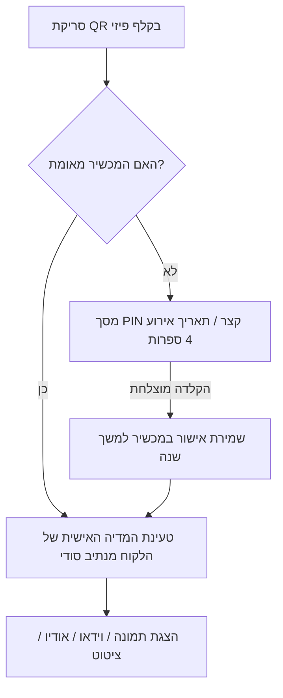

# 🎴 מדריך תפעולי: ניהול לקוחות, קבצים, פרטיות ואחסון ענן

מסמך זה מרכז את כל ההנחיות, השיטות המומלצות והארכיטקטורה הטכנית לקליטת לקוחות עבור חפיסות הקלפים המותאמות אישית.

---

## 1. השיטה המומלצת להעברת קבצים מהלקוח

עבור 54 קלפים המשלבים תמונות, סרטונים, הקלטות קוליות וטקסטים:

### 🏆 אפשרות א' (המומלצת ביותר): טופס ייעודי (Google Form)
* **איך זה עובד:** יוצרים טופס Google Form קבוע. 
* **מבנה הטופס:** הטופס מחולק לפי 4 סדרות (תלתן, יהלום, לב, עלה - 13 קלפים בכל סדרה) + 2 ג'וקרים.
* **לכל קלף הלקוח ממלא 3 שדות בלבד:**
  1. **שנה:** (למשל `1985` או `1992`).
  2. **כותרת / ציטוט אישי:** (למשל: "החתונה בירושלים", "הולדת הבן הבכור").
  3. **קובץ מצורף:** העלאת תמונה / סרטון / הקלטה (או השארת השדה ריק אם מדובר בטקסט בלבד).
* **יתרונות:**
  * הלקוח אינו צריך להבין בטכנולוגיה – הטופס מנחה אותו צעד-אחר-צעד מהסמארטפון או מהמחשב.
  * כל התשובות והקבצים נאספים אוטומטית לתוך גיליון אקסל (Google Sheet) מסודר וממויין לפי סדר כרונולוגי.
  * נמנע בלבול של קבצים ללא שמות או תאריכים.

### אפשרות ב': תיקיית ענן משותפת (Google Drive / OneDrive / Dropbox)
* פותחים תיקייה עם שם הלקוח (למשל: `חפיסת_משפחת_לוי_2026`).
* שולחים ללקוח קישור להעלאה + קובץ אקסל תבנית מוכן (ראו סעיף 2).
* הלקוח גורר את כל הקבצים לתיקייה.

> [!WARNING]
> **מדוע לא מומלץ להשתמש ב-WhatsApp?**  
> ווטסאפ דוחס ומוריד משמעותית את איכות התמונות והסרטונים, ומוחק את המטא-דאטה (תאריכים מקוריים). עבור מוצר פרימיום מודפס, מומלץ לקבל קבצים באיכות מקורית דרך גוגל פורם או גוגל דרייב.

---

## 2. שיטת סימון השנה ושמות הקבצים

כדי לשמור על סדר כרונולוגי מושלם (קלף 1 = השנה המוקדמת ביותר, קלף 52 = השנה המאוחרת ביותר):

### מוסכמת שמות קבצים סטנדרטית (Naming Convention):
```text
[מספר_קלף]_[שנה]_[תיאור_קצר].[סיומת]
```
**דוגמאות:**
* `01_1985_החתונה_בירושלים.jpg`
* `02_1988_טיול_ירח_דבש.mp4`
* `03_1991_הולדת_עומר.mp3`
* `15_2004_בת_מצווה_שיר.jpg`
* `53_גוקר_אדום_ברכה_מסבא.mp4`
* `54_גוקר_צהוב_קולאז_משפחתי.jpg`

### תבנית אקסל מוכנה מראש לשליחה ללקוח:
| מספר קלף | שנה | כותרת / אירוע | סוג מדיה | הערות / טקסט שיופיע בסריקה |
| :---: | :---: | :---: | :---: | :---: |
| 1 | 1985 | יום הנישואין | תמונה | "הרגע שבו הכל התחיל באולמי נוף..." |
| 2 | 1987 | מעבר לדירה הראשונה | וידאו | סרטון קצר משיפוץ הבית |
| ... | ... | ... | ... | ... |
| 53 | ג'וקר 1 | ברכה מכל הילדים | וידאו | ג'וקר אדום |
| 54 | ג'וקר 2 | מסר לדורות הבאים | הקלטה | ג'וקר צהוב |

---

## 3. שמירת קבצי הלקוחות והבטחת פרטיות מוחלטת

מאחר ומדובר בתמונות, סרטונים והקלטות אישיות של משפחות, **אף לקוח לא מורשה לראות קבצים של לקוח אחר**.

### הארכיטקטורה המומלצת לפרטיות (בשתי רמות הגנה):



1. **רמה 1: נתיב סודי בלתי ניתן לניחוש (Secret UUID Path):**
   * כל לקוח מקבל מזהה אקראי ארוך בן 32 תווים.
   * ה-QR בקלפים שלו מצביע לנתיב הסודי בלבד, למשל:  
     `https://memories.co.il/v/a8f93e21-bc74-42d1-9f0a-8192a7c41e55/?card=12`
   * אין שום אינדקס פתוח ואי אפשר לגלות או לנחש לקוחות אחרים.
2. **רמה 2: הגנת PIN משפחתי (4 ספרות):**
   * לכל חבילה מוגדר קוד בן 4 ספרות (למשל שנת האירוע: `1985` או 4 הספרות האחרונות של טלפון המזמין).
   * בסריקה הראשונה המשתמש מזין את הקוד פעם אחת בלבד.
   * הדפדפן שומר את האישור (ב-Local Storage), וכל שאר 53 הקלפים ייפתחו מיד ללא צורך בהקשה חוזרת.

---

## 4. מדיניות מחיקת קבצים וזמני אחסון מומלצים

> [!IMPORTANT]
> **הציפייה של הלקוח:**  
> קלפי משחק פיזיים הם מוצר יוקרתי שנשמר שנים רבות. אם לקוח ישלוף את החפיסה בעוד שנתיים, יסרוק קלף ויקבל שגיאת `404 - הדף לא נמצא`, החוויה תיפגע קשות.

### המודל המומלץ למדיניות אחסון:

1. **אחסון בענן כלול במחיר החבילה למשך 3 שנים לפחות (או 5 שנים):**
   * מכיוון שעלויות האחסון בענן כיום אפסיות (פירוט בסעיף 5), ניתן להציע 3 עד 5 שנות אחסון מלאות ללא כל עלות מורגשת עבורך.
2. **גיבוי דיגיטלי מלא ללקוח (Digital Archive):**
   * במעמד מסירת החפיסה, שולחים ללקוח קישור להורדת ארכיון דיגיטלי (קובץ ZIP) של כל 54 הקבצים כפי שהוטמעו באתר.
   * מסר ללקוח: *"הקלפים שלכם מחוברים לענן למשך 3 שנים. בנוסף, כל המדיה והזיכרונות שלכם מגובים אצלכם לתמיד!"*
3. **אפשרות הארכה בתום התקופה (במידת הצורך):**
   * לאחר 3-5 שנים, ניתן לשלוח ללקוח מייל המציע הארכה לשלוש שנים נוספות בעלות סמלית (למשל 39 ₪).
   * במידה והלקוח אינו מעוניין, שולחים לו תזכורת חודש מראש לפני העברת הקבצים לארכיון.

---

## 5. עלויות אחסון והקמת האתר: האם יש אפשרות חינמית?

### ✅ חדשות מצוינות: ניתן להריץ את המערכת ב-100% חינם!

| שירות | מסלול חינמי (Free Tier) | מה מקבלים בחינם? | עלות לחודש |
| :--- | :--- | :--- | :--- |
| **Cloudflare Pages + R2** | חינם לכל החיים | **10 GB אחסון חינם**, רוחב פס ללא הגבלה, 0 ₪ על תעבורה (Zero Egress) | **0 ₪** |
| **Firebase Storage (Google)** | Spark Free Plan | 5 GB אחסון חינם, 1 GB תעבורה ליום | **0 ₪** |
| **GitHub Pages** | ציבורי חינם | אירוח דפי HTML/JS סטטיים | **0 ₪** |

### 💡 כמה חפיסות לקוחות נכנסות ב-10 GB בחינם?
* חפיסה ממוצעת (14 תמונות קלות + 14 סרטונים קצרים דחוסים היטב של 10-15 שניות + 14 הקלטות קול + טקסט) שוקלת סביב **100 עד 150 MB בלבד**.
* **ב-10 GB חינם של Cloudflare R2 ניתן לאחסן בין 70 ל-100 חפיסות לקוחות שלמות מבלי לשלם אגורה אחת!**
* גם אם תחרגי מעבר ל-100 לקוחות, המחיר ב-Cloudflare הוא רק **$0.015 (כ-5 אגורות) לחודש עבור ג'יגה-בייט שלם נוסף**.

### 🌟 ההוצאה היחידה המומלצת (אופציונלית בלבד):
* **דומיין אישי ממותג (למשל `www.magic-cards.co.il`):**  
  עלות של כ-**45 עד 65 ₪ לשנה בלבד** (כ-5 ₪ בחודש).
  זה מעניק מראה יוקרתי ומקצועי למותג שלך כאשר הלקוחות והאורחים סורקים את ה-QR.

---

## 6. סיכום תהליך עבודה מומלץ (Workflow) מול לקוח חדש

1. **הזמנה:** הלקוח מזמין חפיסה ומקבל קישור ל-Google Form או תיקיית דרייב עם טבלת האקסל.
2. **איסוף חומרים:** הלקוח מזין את השנים (ממוינות כרונולוגית), הכותרות והמדיה עבור 52 הקלפים + 2 ג'וקרים.
3. **בדיקה ויצירה:** מעבירים את הקבצים תהליך אופטימיזציה מהיר (דחיסת תמונות וסרטונים לגודל קל לסמארטפונים).
4. **שיוך מזהה ייחודי (UUID + PIN):** מקצים ללקוח תיקייה מוגנת ויוצרים עבורו את קובצי ה-QR.
5. **הדפסה ומסירה:** מדפיסים את הקלפים הפיזיים (דרך `universal_print.html`) ומוסרים ללקוח יחד עם קישור גיבוי לכל הקבצים.
