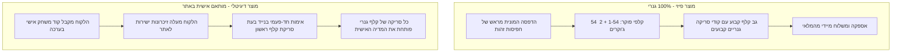

# 🎴 מדריך תפעולי מקיף: מודל חפיסה גנרית מהמלאי, פורטל העלאה, חוקי משחק ופרטיות

מסמך זה מרכז את כל התובנות, הארכיטקטורה העסקית, חוקי המשחק והפתרונות הטכנולוגיים של המוצר: **חפיסת קלפים פיזית גנרית מהמלאי בשילוב פורטל העלאה דיגיטלי עצמאי ללקוח**.

---

## 1. עקרון הליבה: הפרדה מלאה בין המוצר הפיזי לתוכן הדיגיטלי

* **החפיסה הפיזית:** אחידה, גנרית, חתומה ומודפסת מראש בכמויות גדולות (לפי הקובץ `universal_print.html`).  
  לכל הלקוחות נשלחת בדיוק אותה חבילה אחידה! אין בה שום פתקאות, קודים מודפסים, מדבקות או דפי פתרונות ידניים.
* **התוכן הדיגיטלי:** נוצר ומנוהל כולו אונליין. בעת הרכישה/התשלום באתר נוצר עבור הלקוח קוד אישי ייחודי המוצג במסך סיום ההזמנה (ונשלח במסרון/מייל).  
  הלקוח מעלה את התוכן בעצמו ישירות דרך האתר בפורטל הייעודי (`builder.html`), ללא שום צורך בשליחת קבצים למפעיל.

---

## 2. העלאה ישירה של הלקוח באתר (פורטל עצמאי)

במקום לשלוח קבצים בתוכנות מסרים, במייל או בטפסים חיצוניים, הלקוח מנהל את התוכן שלו בעצמו בקלות:

### 🏆 איך זה עובד שלב-אחר-שלב עבור הלקוח:
1. **קבלת קוד אישי לאחר תשלום:**  
   מיד עם השלמת התשלום באתר, המערכת מייצרת עבור הלקוח **קוד חפיסה ייחודי** (למשל `FAMILY-2026` או 4 ספרות) יחד עם קישור כניסה ישיר לפורטל.
2. **כניסה לפורטל ההעלאה (`builder.html`):**  
   הלקוח נכנס מהסמארטפון או מהמחשב, מזין את הקוד, ומקבל לוח אינטואיטיבי של 54 הקלפים (1 עד 54).
3. **הזנת המדיה בקצב אישי:**  
   עבור כל קלף הלקוח ממלא:
   * **שנה:** (למשל `1995`).
   * **כותרת / אירוע:** (למשל: "החתונה של אבא ואמא").
   * **רמז לשחקנים:** (שאלה שמוצגת לפני שחושפים את השנה: "נחשו באיזה עשור נפגשנו לראשונה?").
   * **מדיה:** העלאת תמונה ישירות מגלריית הנייד, סרטון קצר, או הקלטה קולית.
4. **השלמה אוטומטית מטריוויה (מודל היברידי קל ומהיר):**  
   אם ללקוח יש רק 25 תמונות ואין לו כוח או זמן למלא את כל 54 הקלפים, הוא לוחץ על כפתור הקסם:  
   *"השלמה אוטומטית מטריוויה"* – והמערכת משלימה מיד את כל הקלפים שנותרו ריקים בשאלות טריוויה היסטוריות מרתקות מתוך המשחק הכללי (בטהובן, נחיתה על הירח, מגדל אייפל ועוד)!
5. **שמירה אמינה ללא הגבלת נפח (בין הפעלה להפעלה):**  
   האתר משתמש במסד נתונים מקומי מלא בדפדפן (`IndexedDB`) לצד זיכרון מקומי רגיל.  
   זה מבטיח שאפילו עשרות תמונות כבדות נשמרות באופן מלא במכשיר ולא נמחקות לעולם אם סוגרים את הטאב, מכבים את הטלפון או מרעננים את העמוד.
6. **הפעלת המשחק:**  
   בסיום, הלקוח לוחץ על "הפעל משחק" או שומר, והמשחק מוכן מיידית להפעלה בסמארטפונים.

---

## 3. חוקי המשחק ושחזור שנים על השולחן (מנגנון סריקה חוזרת חכם)

על גבי הקלפים הפיזיים מודפסים רק סמלי הפוקר והמספר הסידורי בפינות (1 עד 54), **ללא השנה** (כדי שניתן יהיה לשחק ולנחש).  
איך מתנהל המשחק בפועל, ואיך יודעים מה השנה של קלף שנחשף לפני כמה תורות?

### א. מהלך המשחק הפיזי:
1. כל שחקן מקבל מספר קלפים סגורים ליד (למשל 5 קלפים).
2. קלף פתיחה אחד מונח במרכז השולחן כששנתו ידועה (זהו עוגן ציר הזמן).
3. בתורו, שחקן בוחר קלף מידו, מנחש איפה הוא משתלב על ציר הזמן (לפני הקלפים שעל השולחן, ביניהם, או אחריהם), ומניח אותו במיקום המשוער.
4. השחקן סורק את קוד הקישור שעל גב הקלף בסמארטפון שלו, צופה במדיה ולוחץ על **"חשוף את השנה"**.
5. **אם הצדק עמו:** הקלף נשאר על השולחן כחלק מציר הזמן המתארך!  
   **אם טעה:** הקלף נזרק לערימת הפסילה והשחקן לוקח קלף חדש. המנצח הוא הראשון שנפטר מכל קלפיו.

### ב. מנגנון הסריקה החוזרת (השולחן הוא ציר הזמן היחיד):
אין צורך לשמור בטלפון רשימות או מגירות של ציר זמן דיגיטלי. השולחן הפיזי הוא ציר הזמן האמיתי והחי!  
המערכת פועלת במנגנון זיכרון חכם לפי סריקות:

1. **סריקה ראשונה (מצב מסתורין):**  
   כאשר סורקים קלף בפעם הראשונה, השנה מוסתרת לחלוטין. רואים רק את התמונה/המדיה ואת שאלת הרמז. השחקנים מנחשים ולוחצים "חשוף את השנה".
2. **סריקה חוזרת (קלף שכבר נחשף על השולחן):**  
   אם בהמשך הערב שחקן רוצה להיזכר מה השנה של קלף שכבר מונח על השולחן, או לבדוק איפה לשבץ קלף חדש ביחס אליו – **הוא פשוט סורק שוב את הקלף מהשולחן!**  
   המכשיר מזהה מיד שהקלף כבר נחשף, ופותח ישירות את התמונה יחד עם השנה בבירור ובאופן בולט (עם כיתוב: *"קלף זה כבר נחשף ונמצא על השולחן (שנת 1985)"*). אין צורך לנחש שוב!
3. **הסוד המתמטי של המספר הסידורי (1 עד 54):**  
   מכיוון שהחפיסה ממוינת מראש לפי סדר השנים (קלף 1 = המוקדם ביותר, קלף 54 = המאוחר ביותר), המספר המודפס בפינת הקלף כבר רומז על מיקומו היחסי: אם על השולחן יש קלף #8 וקלף #20, קלף #14 בהכרח חייב להיות ביניהם!
4. **איפוס למשחק חדש:**  
   בסיום המשחק, לחיצה על כפתור "איפוס משחק 🔄" מחזירה את כל הקלפים למצב מסתורין לקראת סיבוב חדש.

### ג. איך מתמודדים עם מספר קלפים מאותה שנה?
זהו מצב טבעי ביותר במשפחות (למשל: טיול לחו"ל ב-1995, וגם חתונה ב-1995).

* **כלל השוויון הרשמי (מקובל במשחקי ציר זמן בינלאומיים):**  
  אם על השולחן כבר מונח קלף משנת `1995`, ושחקן מניח קלף נוסף ששנתו היא `1995`:  
  **הנחה מימין לקלף הקיים, משמאל לקלף הקיים, או בצמוד אליו – נחשבת נכונה וחוקית ב-100%!**  
  השחקן אינו נפסל, כי שני האירועים שייכים לאותה שנה.
* **סדר כרונולוגי פנימי בפורטל:**  
  בעת העלאת החומרים בפורטל, הלקוח מסדר את אירועי אותה שנה לפי סדר החודשים (אירוע של מרץ 1995 יהיה קלף 14, ואירוע של ספטמבר 1995 יהיה קלף 15).

---

## 4. מנגנון האימות, הפרטיות ואחסון הענן

קודי הקישור (קודי הסריקה) שעל גבי הקלפים הפיזיים הם **גנריים וקבועים** ומפנים לכתובת אחידה:  
`https://[Domain]/index.html?card=[1-54]`

### מנגנון האימות והשיוך (קוד חפיסה אישי שנוצר באתר):
1. **היווצרות הקוד באתר:**  
   לאחר התשלום, הלקוח מקבל קוד ייחודי אישי (למשל `FAMILY-2026`).
2. **בסריקה הראשונה של קלף כלשהו באירוע:**  
   האתר מזהה שהמכשיר עדיין אינו משויך לאף משפחה ומציג חלונית קצרה:  
   *"ברוכים הבאים! אנא הזינו את קוד המשחק שלכם"*.
   לחלופין, המארח יכול לשלוח קישור ישיר לקבוצת הווטסאפ של המשפחה: `https://[Domain]/?deck=FAMILY-2026` וכל מכשיר שמקליק על הקישור מסתנכרן אוטומטית ברגע!
3. **שמירה מקומית במכשיר:**  
   ברגע שהקוד הוזן פעם אחת, הוא נשמר במכשיר של אותו אורח לכל הערב.
4. **חוויה שוטפת ומהירה:**  
   כל שחקן שסורק כל קלף מהחפיסה הגנרית (קלף 1, 15, 42 או ג'וקר) מגיע מיד אל המדיה והשנה של אותה משפחה, ללא צורך בהקלדה חוזרת.
5. **פרטיות מוחלטת:**  
   כל משפחה מקבלת מחיצת אחסון נפרדת המוגנת על ידי הקוד שלה. אף לקוח אינו יכול לצפות בזיכרונות של לקוח אחר.

---

## 5. מדיניות מחיקת קבצים: "חלון אירוע" (30 עד 60 יום) ומחיקה מלאה אצלך

כדי למנוע צבירת קבצים פרטיים של לקוחות, להסיר אחריות משפטית ולשמור על אפס עלויות ופרטיות מרבית:

1. **אחסון פעיל לתקופת האירוע (בין 30 ל-60 יום):**  
   המדיה זמינה בענן כדי שכל האורחים והמשפחה יוכלו לסרוק את הקלפים ולשחק במהלך האירוע והחודש שלאחריו.
2. **הורדת ארכיון דיגיטלי מלא (קובץ זיפ) בלחיצת כפתור:**  
   הלקוח מקבל בפורטל כפתור בולט: *"הורדת ארכיון זיכרונות (קובץ זיפ)"*.  
   הוא שומר אצלו במחשב, בטלפון או בתיקיית הענן האישית שלו את כל 54 הקבצים כפי שהוטמעו באתר.
3. **מחיקה מלאה מהענן שלך (אפס שמירת מידע):**  
   בתום תקופת חלון האירוע, התיקייה של הלקוח נמחקת לחלוטין מהענן שלך.  
   נשלחת לו תזכורת אוטומטית שבוע מראש לוודא שהוריד את הגיבוי האישי.
4. **אפשרות משחק עתידי גם בעוד שנים:**  
   גם בעוד שנים רבות, הלקוח יכול להיכנס לאתר מכל מכשיר, לטעון את קובץ הגיבוי שהוריד, ולשחק שוב עם החפיסה הפיזית ללא שום תלות בשרת שלך!

---

## 6. סיכום תהליך עבודה מלא מול לקוח (Workflow)

| שלב | מי מבצע? | מה קורה בפועל? |
| :--- | :---: | :--- |
| **1. הזמנה ותשלום באתר** | הלקוח | הלקוח מבצע תשלום באתר. מיד בסיום נוצר עבורו קוד משחק ייחודי וקישור ישיר לפורטל. |
| **2. משלוח חפיסה אחידה** | את (זהבית) | שולחת חפיסה גנרית מוכנה וסגורה מהמלאי (זהה לכולם, ללא שום פתקאות או קודים מודפסים). |
| **3. העלאת זיכרונות** | הלקוח | הלקוח נכנס לפורטל (`builder.html`) עם הקוד שלו ומעלה את 54 הרגעים (עם אפשרות להשלמה אוטומטית מטריוויה). |
| **4. גיבוי אישי** | הלקוח | מוריד בלחיצה אחת קובץ ארכיון זיפ עם כל המדיה והנתונים למחשב האישי שלו. |
| **5. ערב המשחק** | המשפחה והאורחים | סורקים את קלפי החפיסה הגנרית. סריקה ראשונה = מצב תעלומה (שנה מוסתרת). סריקה נוספת = מציגה מיד את התמונה והשנה של הקלף שעל השולחן! השולחן הפיזי הוא ציר הזמן. |
| **6. סיום חלון האירוע** | מערכת | לאחר 30 עד 60 יום הקבצים נמחקים מהענן שלך. אפס עלות אחסון ואפס אחריות משפטית. |
