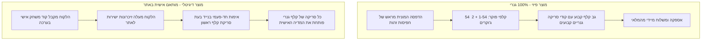

# 🎴 מדריך תפעולי מקיף: מודל חפיסה גנרית מהמלאי, פורטל העלאה, חוקי משחק ופרטיות

מסמך זה מרכז את כל התובנות, הארכיטקטורה העסקית, חוקי המשחק והפתרונות הטכנולוגיים של המוצר: **חפיסת קלפים פיזית גנרית מהמלאי בשילוב פורטל העלאה דיגיטלי עצמאי ללקוח**.

---

## 1. עקרון הליבה: הפרדה מלאה בין המוצר הפיזי לתוכן הדיגיטלי

* **החפיסה הפיזית:** אחידה, גנרית ומודפסת מראש בכמויות גדולות (לפי הקובץ `universal_print.html`).  
  אין שום צורך בהדפסה מותאמת אישית או יקרה לכל לקוח בנפרד!
* **התוכן הדיגיטלי:** הלקוח מעלה את התוכן בעצמו ישירות דרך האתר בפורטל הייעודי (`builder.html`).  
  אין צורך בשליחת קבצים למפעיל, במילוי טפסים חיצוניים או בהזנת נתונים ידנית מצדך.

---

## 2. העלאה ישירה של הלקוח באתר (פורטל עצמאי)

במקום לשלוח קבצים בתוכנות מסרים, במייל או בטפסים חיצוניים, הלקוח מנהל את התוכן שלו בעצמו בקלות:

### 🏆 איך זה עובד שלב-אחר-שלב עבור הלקוח:
1. **קבלת קוד אישי:**  
   הלקוח מקבל עם החפיסה כרטיס מעוצב עם **קוד משחק אישי** (למשל `FAMILY-2026`) וקישור לאתר.
2. **כניסה לפורטל ההעלאה (`builder.html`):**  
   הלקוח נכנס מהסמארטפון או מהמחשב, מזין את הקוד, ומקבל לוח אינטואיטיבי של 54 הקלפים (1 עד 54).
3. **הזנת המדיה בקצב אישי:**  
   עבור כל קלף הלקוח ממלא:
   * **שנה:** (למשל `1995`).
   * **כותרת / אירוע:** (למשל: "החתונה של אבא ואמא").
   * **רמז לשחקנים:** (שאלה שמוצגת לפני שחושפים את השנה: "נחשו באיזה עשור נפגשנו לראשונה?").
   * **מדיה:** העלאת תמונה ישירות מגלריית הנייד, סרטון קצר, או הקלטה קולית.
4. **השלמה אוטומטית מטריוויה (מודל היברידי קל ומהיר):**  
   אם ללקוח יש רק 25 תמונות ואין לו כוח או זמן למלא את כל 54 הקלפים, הוא לוחץ על כפתור הקסם:  
   *"השלמה אוטומטית מטריוויה"* – והמערכת משלימה מיד את כל הקלפים שנותרו ריקים בשאלות טריוויה היסטוריות מרתקות מתוך המשחק הכללי (בטהובן, נחיתה על הירח, מגדל אייפל ועוד)!
5. **שמירה אמינה ללא הגבלת נפח (בין הפעלה להפעלה):**  
   האתר משתמש במסד נתונים מקומי מלא בדפדפן (`IndexedDB`) לצד זיכרון מקומי רגיל.  
   זה מבטיח שאפילו עשרות תמונות כבדות נשמרות באופן מלא במכשיר ולא נמחקות לעולם אם סוגרים את הטאב, מכבים את הטלפון או מרעננים את העמוד.
6. **הפעלת המשחק:**  
   בסיום, הלקוח לוחץ על "הפעל משחק" או שומר, והמשחק מוכן מיידית להפעלה בסמארטפונים.

---

## 3. חוקי המשחק ושחזור שנים על השולחן

על גבי הקלפים הפיזיים מודפסים רק סמלי הפוקר והמספר הסידורי בפינות (1 עד 54), **ללא השנה** (כדי שניתן יהיה לשחק ולנחש).  
איך מתנהל המשחק בפועל, ואיך יודעים מה השנה של קלף שנחשף לפני כמה תורות?

### א. מהלך המשחק הפיזי:
1. כל שחקן מקבל מספר קלפים סגורים ליד (למשל 5 קלפים).
2. קלף פתיחה אחד מונח במרכז השולחן כששנתו ידועה (זהו עוגן ציר הזמן).
3. בתורו, שחקן בוחר קלף מידו, מנחש איפה הוא משתלב על ציר הזמן (לפני הקלפים שעל השולחן, ביניהם, או אחריהם), ומניח אותו במיקום המשוער.
4. השחקן סורק את קוד הקישור שעל גב הקלף בסמארטפון שלו, צופה במדיה ולוחץ על **"חשוף את השנה"**.
5. **אם הצדק עמו:** הקלף נשאר על השולחן כחלק מציר הזמן המתארך!  
   **אם טעה:** הקלף נזרק לערימת הפסילה והשחקן לוקח קלף חדש. המנצח הוא הראשון שנפטר מכל קלפיו.

### ב. איך משחזרים לאיזו שנה שייך כל קלף שמונח על השולחן?
כשיש 10 קלפים פזורים על השולחן עם מספרים בלבד (למשל #5, #14, #28), יש שלוש דרכים נוחות לדעת מה השנה של כל קלף:

1. **הסוד המתמטי של החפיסה (מספר הקלף מציג את מקומו בציר):**  
   החפיסה ממוינת מראש בסדר כרונולוגי עולה (קלף 1 = השנה הכי מוקדמת, קלף 54 = השנה הכי מאוחרת).  
   לכן, אם על השולחן מונחים קלף #5 וקלף #18, קלף #12 **תמיד ובאופן מוחלט** יימצא ביניהם! המספר עצמו משקף את המיקום בציר.
2. **"ציר הזמן שעל השולחן" (שרשרת חיה באפליקציה ב-`index.html`):**  
   בכל פעם ששחקן לוחץ "חשוף את השנה", הקלף מתווסף אוטומטית לרשימת הקלפים שנחשפו.  
   בראש המסך מופיע סרגל: *"ציר הזמן שעל השולחן"*. לחיצה עליו מציגה שרשרת מסודרת של כל הקלפים שעל השולחן:  
   `[#4 תלתן • 1988: החתונה] ➔ [#14 יהלום • 1995: הטיול] ➔ [#31 לב • 2004: בר מצווה]`  
   כל שחקן יכול להציץ בסמארטפון בכל רגע ולראות את השנה המדויקת של כל קלף שמונח על השולחן.
3. **דף מפתח שנים להדפסה (דף פתרונות מקופל בקופסה):**  
   בפורטל יש כפתור: *"מפתח שנים להדפסה"*. הוא מפיק דף טבלה מסודר של 54 הקלפים והשנים שלהם. אפשר להדפיס אותו, לקפל ולהניח סגור בקופסה עבור שופט המשחק או לבדיקה בסיום.

### ג. איך מתמודדים עם מספר קלפים מאותה שנה?
זהו מצב טבעי ביותר במשפחות (למשל: טיול לחו"ל ב-1995, וגם חתונה ב-1995).

* **כלל השוויון הרשמי (מקובל במשחקי ציר זמן בינלאומיים):**  
  אם על השולחן כבר מונח קלף משנת `1995`, ושחקן מניח קלף נוסף ששנתו היא `1995`:  
  **הנחה מימין לקלף הקיים, משמאל לקלף הקיים, או בצמוד אליו – נחשבת נכונה וחוקית ב-100%!**  
  השחקן אינו נפסל, כי שני האירועים שייכים לאותה שנה.
* **סדר כרונולוגי פנימי בפורטל:**  
  בעת העלאת החומרים בפורטל, הלקוח מסדר את אירועי אותה שנה לפי סדר החודשים (אירוע של מרץ 1995 יהיה קלף 14, ואירוע של ספטמבר 1995 יהיה קלף 15).

---

## 4. מנגנון האימות, הפרטיות ואחסון הענן

קודי הקישור (קודי הסריקה) שעל גבי הקלפים הפיזיים הם **גנריים וקבועים** ומפנים לכתובת אחידה:  
`https://[Domain]/index.html?card=[1-54]`

### מנגנון האימות והשיוך (קוד חפיסה אישי):
1. **בסריקה הראשונה של קלף כלשהו באירוע:**  
   האתר מזהה שהמכשיר עדיין אינו משויך לאף משפחה ומציג חלונית קצרה:  
   *"ברוכים הבאים! אנא הזינו את קוד המשחק שלכם (המופיע בקופסה)"*.
2. **שמירה מקומית במכשיר:**  
   ברגע שהקוד הוזן פעם אחת, הוא נשמר במכשיר של אותו אורח.
3. **חוויה שוטפת ומהירה:**  
   כל שחקן שסורק כל קלף מהחפיסה הגנרית (קלף 1, 15, 42 או ג'וקר) מגיע מיד אל המדיה והשנה של אותה משפחה, ללא צורך בהקלדה חוזרת.
4. **פרטיות מוחלטת:**  
   כל משפחה מקבלת מחיצת אחסון נפרדת המוגנת על ידי הקוד שלה. אף לקוח אינו יכול לצפות בזיכרונות של לקוח אחר.

---

## 5. מדיניות מחיקת קבצים: "חלון אירוע" (30 עד 60 יום) ומחיקה מלאה אצלך

כדי למנוע צבירת קבצים פרטיים של לקוחות, להסיר אחריות משפטית ולשמור על אפס עלויות ופרטיות מרבית:

1. **אחסון פעיל לתקופת האירוע (בין 30 ל-60 יום):**  
   המדיה זמינה בענן כדי שכל האורחים והמשפחה יוכלו לסרוק את הקלפים ולשחק במהלך האירוע והחודש שלאחריו.
2. **הורדת ארכיון דיגיטלי מלא (קובץ זיפ) בלחיצת כפתור:**  
   הלקוח מקבל בפורטל כפתור בולט: *"הורדת ארכיון זיכרונות (קובץ זיפ)"*.  
   הוא שומר אצלו במחשב, בטלפון או בתיקיית הענן האישית שלו את כל 54 הקבצים כפי שהוטמעו באתר.
3. **מחיקה מלאה מהענן שלך (אפס שמירת מידע):**  
   בתום תקופת חלון האירוע, התיקייה של הלקוח נמחקת לחלוטין מהענן שלך.  
   נשלחת לו תזכורת אוטומטית שבוע מראש לוודא שהוריד את הגיבוי האישי.
4. **אפשרות משחק עתידי גם בעוד שנים:**  
   גם בעוד שנים רבות, הלקוח יכול להיכנס לאתר מכל מכשיר, לטעון את קובץ הגיבוי שהוריד, ולשחק שוב עם החפיסה הפיזית ללא שום תלות בשרת שלך!

---

## 6. סיכום תהליך עבודה מלא מול לקוח (Workflow)

| שלב | מי מבצע? | מה קורה בפועל? |
| :--- | :---: | :--- |
| **1. הזמנת חפיסה** | הלקוח | הלקוח מזמין חפיסה באתר/בחנות. |
| **2. משלוח מיידי** | את (זהבית) | מוציאה חפיסה פיזית גנרית מהמלאי יחד עם כרטיס הנושא קוד משחק אישי. |
| **3. העלאת זיכרונות** | הלקוח | הלקוח נכנס לפורטל (`builder.html`), מזין את הקוד ומעלה את 54 התמונות, השנים והסרטונים בקצב שלו (עם אפשרות להשלמה אוטומטית מטריוויה). |
| **4. גיבוי אישי** | הלקוח | לוחץ על כפתור הורדת ארכיון זיפ ושומר את כל הזיכרונות אצלו במחשב לתמיד. |
| **5. יום האירוע והמשחק** | המשפחה והאורחים | סורקים את קלפי החפיסה הגנרית (הזנת קוד פעם אחת בלבד בנייד) ונהנים ממשחק זיכרונות מרגש עם ציר זמן חי! |
| **6. סיום חלון האירוע** | מערכת | לאחר 30 עד 60 יום הקבצים נמחקים מהענן שלך. אפס עלות ואפס אחריות מתמשכת עבורך. |
