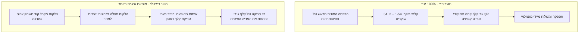
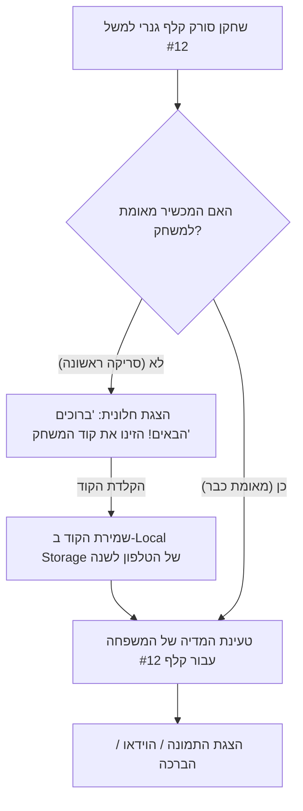

# 🎴 מדריך תפעולי: מודל חפיסה גנרית מהמלאי, העלאה עצמית באתר, פרטיות ואחסון ענן

מסמך זה מרכז את הארכיטקטורה העסקית והטכנית של המוצר: **חפיסת קלפים פיזית גנרית מהמלאי בשילוב פורטל העלאה דיגיטלי עצמאי ללקוח**.

---

## 1. עקרון הליבה: הפרדה מלאה בין המוצר הפיזי לתוכן הדיגיטלי

* **החפיסה הפיזית:** אחידה, גנרית ומודפסת מראש בכמויות גדולות (לפי [universal_print.html](file:///c:/Users/zehavit/OneDrive/%D7%9E%D7%A1%D7%9E%D7%9B%D7%99%D7%9D/CardGame/universal_print.html)).  
  אין שום צורך בהדפסה מותאמת אישית או יקרה לכל לקוח בנפרד!
* **התוכן הדיגיטלי:** הלקוח מעלה את התוכן בעצמו ישירות דרך האתר.  
  אין צורך בשליחת קבצים לזהבית, במילוי טפסים חיצוניים או בהזנת נתונים ידנית.

---

## 2. העלאה ישירה של הלקוח באתר (Self-Service Portal)

במקום לשלוח קבצים ב-WhatsApp, במייל או ב-Google Forms, הלקוח מנהל את התוכן שלו בעצמו:

### 🏆 איך זה עובד שלב-אחר-שלב עבור הלקוח:
1. **קבלת קוד אישי:**  
   הלקוח מקבל עם החפיסה כרטיס מעוצב עם **קוד משחק אישי** (למשל `FAMILY-2026` או 4 ספרות ייחודיות) וקישור לאתר.
2. **כניסה לפורטל ההעלאה:**  
   הלקוח נכנס לאתר מהסמארטפון או מהמחשב, מזין את הקוד, ומקבל לוח אינטואיטיבי של 54 הקלפים (1 עד 54).
3. **הזנת המדיה בקצב אישי:**  
   עבור כל קלף הלקוח ממלא:
   * **שנה:** (למשל `1995`).
   * **כותרת / ציטוט:** (למשל: "טיול הבר-מצווה לאיטליה").
   * **מדיה:** העלאת תמונה ישירות מגלריית הנייד, סרטון קצר או הקלטה קולית.
4. **שמירה אוטומטית (Auto-Save):**  
   המערכת שומרת כל שינוי בזמן אמת. הלקוח יכול להתחיל בנייד, להמשיך למחרת במחשב, ולראות מד התקדמות (למשל: *"35/54 קלפים הושלמו"*).
5. **הפעלת המשחק:**  
   בסיום, הלקוח לוחץ על **"הפעל משחק"** – והתכנים מקושרים מיידית לחפיסה שלו בענן.

### 🌟 היתרונות של שיטה זו:
* **אפס עבודה ידנית עבורך:** אינך צריכה להוריד קבצים, למיין, לשנות שמות או לבנות קבצי JSON.
* **אין תלות בחשבון Google:** כל לקוח יכול להעלות מכל מכשיר ללא התחברות לחשבון חיצוני.
* **חוויית פרימיום:** הלקוח מרגיש שהוא שותף ליצירת המשחק המשפחתי שלו.
* **בקרת איכות מובנית בדפדפן:** האתר מתריע ללקוח אם שכח לציין שנה או אם חסר קובץ.

---

## 3. איך החפיסה הגנרית יודעת מה להציג? (ארכיטקטורת החיבור והפרטיות)

קודי ה-QR שעל גבי הקלפים הפיזיים הם **גנריים וקבועים** ומפנים לכתובת אחידה:  
`https://[Domain]/index.html?card=[1-54]`

### מנגנון האימות והשיוך (Session & PIN / Code):

1. **בסריקה הראשונה של קלף כלשהו באירוע:**  
   האתר מזהה שהמכשיר עדיין אינו משויך לאף משפחה ומציג חלונית קצרה ואלגנטית:  
   *"ברוכים הבאים! אנא הזינו את קוד המשחק שלכם (המופיע בקופסה)"*.
2. **שמירה מקומית (Local Storage):**  
   ברגע שהקוד הוזן פעם אחת, הוא נשמר במכשיר.
3. **מעתה ואילך – חוויה חלקה ומהירה:**  
   כל שחקן שסורק כל קלף מהחפיסה הגנרית (קלף 1, 15, 42 או ג'וקר) מגיע **מיידית וישירות** אל המדיה והשנה של אותה משפחה, ללא שום צורך בהקלדה חוזרת.
4. **פרטיות מוחלטת:**  
   כל משפחה מקבלת מחיצת אחסון נפרדת המוגנת ע"י הקוד שלה. אף לקוח אינו יכול לצפות בזיכרונות של לקוח אחר.

---

## 4. מדיניות מחיקת קבצים: "חלון אירוע" (30–60 יום) ומחיקה מלאה אצלך

כדי למנוע צבירת קבצים פרטיים, להסיר אחריות משפטית ולשמור על אפס עלויות ופרטיות מקסימלית:

### ⏱️ מודל "חלון אירוע" (Event Window):
1. **אחסון פעיל לתקופת האירוע (30 עד 60 יום):**  
   המדיה זמינה בענן כדי שכל האורחים והמשפחה יוכלו לסרוק את הקלפים ולשחק במהלך האירוע והחודש שאחריו.
2. **הורדת ארכיון דיגיטלי מלא (ZIP) בלחיצת כפתור:**  
   הלקוח מקבל בפורטל כפתור בולט: **"📦 הורד את כל הזיכרונות (קובץ ZIP)"**.  
   הוא שומר אצלו במחשב, בטלפון או ב-Google Drive את כל 54 הקבצים כפי שהוטמעו.
3. **מחיקה מלאה מהענן שלך (Zero Data Retention):**  
   בתום תקופת חלון האירוע, התיקייה של הלקוח נמחקת לחלוטין מהענן שלך.  
   שבוע לפני המחיקה נשלחת לו תזכורת אוטומטית לוודא שהוריד את הגיבוי.
4. **אפשרות משחק עתידי (Local Player):**  
   גם בעוד שנים, הלקוח יכול להיכנס לאתר, לטעון את קובץ ה-ZIP מהטלפון לזיכרון המקומי של המכשיר, ולשחק שוב עם החפיסה הפיזית ללא שום תלות בשרת שלך!

---

## 5. סיכום תהליך עבודה מלא (Workflow)

| שלב | מי מבצע? | מה קורה בפועל? |
| :--- | :---: | :--- |
| **1. הזמנת חפיסה** | הלקוח | הלקוח מזמין חפיסה באתר/בחנות. |
| **2. משלוח מיידי** | את (זהבית) | מוציאה חפיסה פיזית גנרית מהמלאי יחד עם כרטיס הנושא קוד משחק אישי. |
| **3. העלאת זיכרונות** | הלקוח | הלקוח נכנס לפורטל, מזין את הקוד ומעלה את 54 התמונות, השנים והסרטונים בקצב שלו. |
| **4. הפעלה** | הלקוח | הלקוח לוחץ "הפעל משחק" – התוכן משויך לקוד בענן. |
| **5. יום האירוע / משחק** | המשפחה והאורחים | סורקים את קלפי החפיסה הגנרית (הזנת קוד פעם אחת בלבד בנייד) ונהנים ממשחק זיכרונות מרגש! |
| **6. תחזוקה** | מערכת | 0 עבודה ידנית עבורך. הכל אוטונומי, יציב ומאובטח. |
