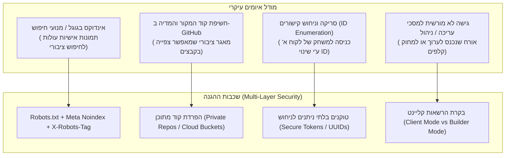
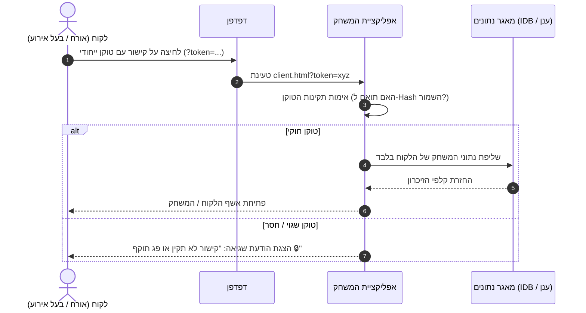

# מפרט אבטחה ופרטיות מקיף • Security & Privacy Architecture
**משחק ציר הזמן • CardGame & PartyGame Ecosystem**  
*מסמך ארכיטקטורה, הגנת מידע ופרטיות לקוחות*

---

## 1. מבוא ומודל האיומים (Executive Summary & Threat Model)

מערכת משחק ציר הזמן משמשת ליצירה, עריכה, הדפסה ומשחק של אירועי זיכרון אישיים, משפחתיים ועסקיים. 
החומרים שמועלים על ידי לקוחות כוללים **מידע רגיש ואישי במיוחד**:
- תמונות משפחתיות ואישיות (חתונות, ימי הולדת, ילדים, שירות צבאי, טיולים).
- סרטוני וידאו ביתיים והקלטות שמע אינטימיות.
- תאריכים מדויקים של אירועי חיים, שמות מלאים ופרטים ביוגרפיים.



---

## 2. הגנה על קוד המקור והמאגרים (Code & Repository Protection)

### 2.1. הפרדת קוד מתוכן לקוחות (Code vs. Customer Data Separation)
המדיניות הבסיסית ביותר באבטחת מידע היא: **קוד המערכת לחוד, ותוכן אישי של לקוחות לחוד.**
- **קוד גנרי (Engine)**: קובצי ה-HTML, ה-CSS וה-JS שמפעילים את המשחק (למשל `game.js`, `play.html`, `style.css`).
- **תוכן לקוח (Customer Assets)**: קובצי תמונות, וידאו, שמע ונתוני JSON ייעודיים (כגון תיקיית `couple37`).

> [!WARNING]
> **סטטוס נוכחי ב-GitHub**:
> - המאגר `zehavitalon/PartyGame` מוגדר כ-**Private** (מוגן ומאובטח).
> - המאגר `zehavitalon/CardGame` מוגדר כרגע כ-**Public**. קבצים המועלים אליו (כולל בתוך `assets/`) גלויים לכל גולש שיודע את כתובת המאגר.

### 2.2. פעולות מומלצות ברמת המאגר:
1. **הפיכת `CardGame` ל-Private**:
   - במידה ומשתמשים ב-GitHub Free: הפיכת המאגר לפרטי עשויה להשבית את GitHub Pages המסורתי (שדורש GitHub Pro למאגרים פרטיים).
   - **פתרון מומלץ חינמי ומאובטח**: מעבר לאירוח ב-**Cloudflare Pages** או **Vercel** – שירותים אלו מתחברים ישירות למאגר GitHub פרטי, מגישים את האתר בחינם ב-HTTPS, ואינם חושפים את קוד המקור או את קבצי המדיה לעולם.
2. **סינון קבצים דרך `.gitignore`**:
   - לוודא שתיקיות המכילות תוכן לקוחות ייחודי אינן עולות למאגר ציבורי.

---

## 3. הגנה מפני מנועי חיפוש וסריקה ציבורית (Search Engine Prevention)

כדי למנוע מכל מנוע חיפוש (Googlebot, Bingbot וכד') לאנדקס את האתר או להציג תוכן לקוחות בחיפושים ציבוריים, הוטמעה גישת הגנה תלת-שכבתית:

### 3.1. שכבה 1: קובץ `robots.txt`
מוגדר בשורש האתר וחוסם באופן גורף כל זחלן מורשה:
```txt
User-agent: *
Disallow: /
```

### 3.2. שכבה 2: תגיות Meta ברמת כל דפי ה-HTML
מוטמעות בתוך תגית ה-`<head>` בכל קובץ HTML במערכת:
```html
<meta name="robots" content="noindex, nofollow, noarchive, nosnippet">
<meta name="googlebot" content="noindex, nofollow, noarchive, nosnippet">
```
- `noindex`: אוסר על הוספת הדף לתוצאות החיפוש.
- `nofollow`: מונע מעבר על קישורים מתוך הדף.
- `noarchive`: אוסר על שמירת עותק מטמון (Cached Version) בשרתי גוגל.
- `nosnippet`: מונע הצגת קטעי טקסט או תצוגה מקדימה.

### 3.3. שכבה 3: קובץ `_headers` (HTTP Response Headers)
```http
/*
  X-Robots-Tag: noindex, nofollow, noarchive
```

---

## 4. בקרת גישה לאשף הלקוח וקישורי משחק (Access Control & Wizard Protection)

### 4.1. הבעיה בקישורים פשוטים / רציפים (Insecure Direct Object Reference)
אם קישור הלקוח נראה כך:
`https://domain.com/client.html?game=37` או `?game=102`  
כל גולש או בוט יכול לשנות את המספר מ-37 ל-38 ולצפות בזיכרונות של לקוח אחר (ID Enumeration Attack).

### 4.2. הפתרון: קישורי גישה בלתי ניתנים לניחוש (Cryptographically Secure Magic Links)
יש לייצר קישור המבוסס על מזהה קריפטוגרפי אקראי באורך 128-ביט לפחות (UUIDv4 או 16 תווים אקראיים בטוחים):
```
https://domain.com/client.html?token=c9a8f21e-7b4d-4e92-bc10-82a170fb98ef
או
https://domain.com/play.html?game=COUPLE-37&key=x9F2aK7vQ1mP
```



### 4.3. שכבת הגנה נוספת: סיסמה משפחתית (Passphrase Protection)
עבור משחקים אישיים רגישים במיוחד, ניתן להוסיף מנגנון הגנה ברמת הלקוח (Client-Side Encryption או Client-Side Gate):
- בעת כניסה ל-`client.html` או ל-`play.html`, מופיע מסך נעילה אלגנטי:  
  *"הזינו את סיסמת האירוע כדי לפתוח את המשחק (לדוגמה: שנת החתונה או מילה סודית)"*.
- המידע נפתח אך ורק לאחר הזנת הסיסמה הנכונה, ללא צורך ברישום מייל או סיבוך טכנולוגי.

### 4.4. הגבלת תוקף לקישור (Link Expiration / TTL)
- קישור אשף הלקוח (`client.html`) להעלאת תמונות צריך להיות פעיל **רק עד תאריך האירוע** (לדוגמה: שבועיים מיום הפקתו).
- לאחר האירוע, האשף ננעל לעריכה (`read-only`), כך שלא ניתן לשנות או להוסיף קלפים בטעות.

---

## 5. הגנה על המדיה ותכני הלקוחות (Media Storage & Client Privacy)

### 5.1. שימוש ב-IndexedDB מקומי (Private Local Storage)
במצב הנוכחי של המערכת, חלק מהנתונים נשמרים ב-IndexedDB המקומי של הדפדפן:
- **יתרון פרטיות עצום**: התמונות והמידע נשמרים ישירות במחשב של המשתמש בלבד (`Origin-locked storage`), ואינם עוברים כלל דרך שרת חיצוני או ענן.
- **מגבלה**: המשחק נגיש רק מאותו מכשיר ודפדפן שבו הוזנו הנתונים.

### 5.2. ארכיטקטורת ענן מתקדמת (Cloud Storage with Signed URLs)
כאשר לקוח מעלה תמונות וסרטונים דרך אשף לקוח ברשת:
1. **שימוש ב-Bucket פרטי לחלוטין (Cloudflare R2 / AWS S3 / Supabase Storage)**:
   הבאקט מוגדר כ-**Private** – שום קובץ אינו נגיש דרך כתובת URL קבועה ברשת.
2. **קישורים חתומים בעלי תוקף קצר (Pre-Signed URLs with Short TTL)**:
   כאשר המשחק פועל, האפליקציה מבקשת קישור זמני (למשל תקף ל-30 דקות בלבד). בתום המשחק, הקישור מתפוגג לחלוטין.

---

## 6. פרטיות במהלך המשחק וקודי QR (Live Game & QR Security)

### 6.1. מה חושף קוד ה-QR המודפס על גבי הקלף הפיזי?
בגרסה הנוכחית, קוד ה-QR מוביל לכתובת:
`https://domain.com/index.html?card=15`

> [!TIP]
> **שיפור פרטיות בקודי ה-QR**:
> כדי למנוע ממי שסרק קלף אחד לנחש את שאר הקלפים או לראות קלפים של לקוחות אחרים:
> - הקישור ב-QR צריך לכלול את מזהה החפיסה הייחודי והטוקן:  
>   `https://domain.com/index.html?game=COUPLE-37-x9F2&c=15`
> - סריקה של ה-QR תציג **רק** את המדיה המסתורית (אודיו / וידאו / תמונה ללא שנה) לצורך הניחוש, מבלי לחשוף את מסך הניהול.

### 6.2. הפרדה בין "מצב לקוח/אורח" ל"מצב בונה/מנהל" (Role-Based Access)
- **Client Mode (`client.html` / `play.html`)**:
  - מיועד למשתתפי המשחק בלבד.
  - כפתורי עריכה, שינוי תשובות, הוספת קלפים, ייצוא ומחיקה **חסומים ומוסתרים לחלוטין**.
  - הברקודים ופרטי המערכת מושבתים.
- **Builder / Admin Mode (`builder.html` / `dashboard.html`)**:
  - מיועד למפיק/מנהל המשחק בלבד.
  - מוגן באמצעות סיסמת ניהול (Admin Key) או גישה מקומית בלבד.

---

## 7. טבלת מצב קיים מול מפת דרכים ליישום (Roadmap & Status)

| רכיב אבטחה | מצב קיים | מצב יעד מומלץ | סטטוס יישום |
| :--- | :--- | :--- | :---: |
| **חסימת גוגל / מנועי חיפוש** | הוטמעו `robots.txt`, תגיות `noindex` ו-`_headers` | בדיקה תקופתית ב-Google Search Console | **הושלם (מוגן) ✅** |
| **הרשאות מאגר PartyGame** | מוגדר כ-Private ב-GitHub | שמירה על פרטיות המאגר | **הושלם (מוגן) ✅** |
| **הרשאות מאגר CardGame** | כרגע Public ב-GitHub | העברה ל-Private + מעבר ל-Cloudflare Pages | **נדרשת החלטה ⚠️** |
| **מניעת ניחוש קישורים (ID Enumeration)** | קישורים לפי קודים (כגון `COUPLE-37`) | שילוב Token/UUID אקראי בכל קישור לקוח | **מומלץ ליישום 🔄** |
| **אשף לקוח מאובטח (`client.html`)** | גישה חופשית לפי פרמטר | הגנת קישור ייחודי (Magic Link) + תוקף קצוב | **מומלץ ליישום 🔄** |
| **נעילת סיסמה למשחק אישי** | אין | אפשרות לסיסמה משפחתית קצרה בפתיחת משחק | **אופציונלי 💡** |

---

## 8. סיכום והנחיות לצוות הפיתוח

1. **אף קובץ מדיה משפחתי אינו מועלה ל-GitHub ללא הגנת `robots.txt` ותגיות `noindex`.** (הוטמע).
2. **כל דף HTML חדש שנוצר במערכת חייב לכלול את תגיות ה-`noindex` וה-`googlebot` בראשו.**
3. **יש להפריד לחלוטין בין ממשק ניהול ובנייה (`builder.html`) לבין ממשק הלקוח והמשחק.**
4. **עבור תוכן לקוחות חיצוני בענן, יש להשתמש אך ורק ב-Buckets פרטיים עם Signed URLs.**
